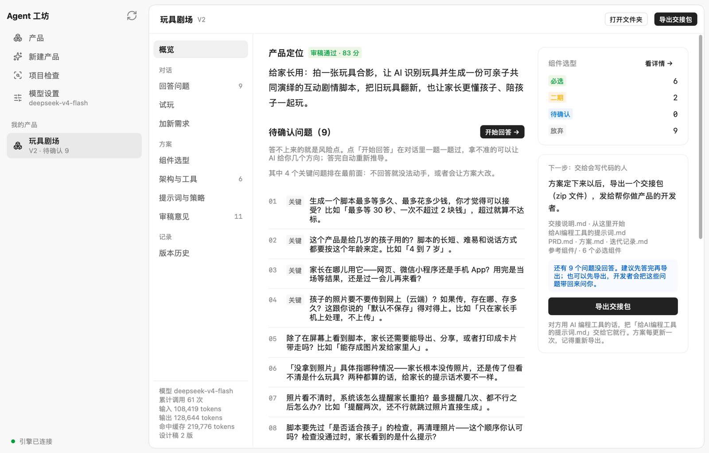
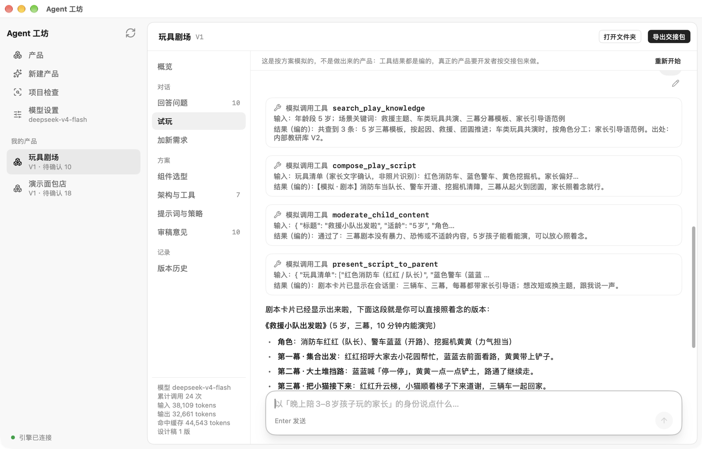

# Agent 工坊 桌面版（Mac，预览）

网页版界面的 macOS 原生重画：用 [Lobe MyGo](https://github.com/lobehub/lobe-mygo)（Go 原生 UI，GPU 绘制，没有 HTML/JS/webview）做成本地桌面应用。

**引擎一行不改**：应用启动时在后台拉起 `python -m blueprint ui --no-browser --port 0`，从 stdout 解析端口，之后走网页版同一套 `/api/*` JSON 接口。`web/` 网页版原样保留，两个界面共用同一个引擎和同一个 `out/` 目录，在哪边建的产品另一边都看得到。

## 能做什么

<table>
<tr>
<td width="50%"></td>
<td width="50%"></td>
</tr>
</table>

功能和网页版一致，页面结构也一样：

- **左栏**：产品、新建产品、项目检查、模型设置四个入口（模型设置下面写着当前模型，没配就写「未配置模型」），下面是「我的产品」列表，底部一个小圆点显示引擎状态。
- **我的产品**：产品表格（版本、名字、状态、更新时间）；还没有产品时是三步引导。
- **产品页**：左边一列分组导航，和网页版相同：
  - 概览：产品定位和审稿分数、待确认问题（前 8 个，可展开）、需求拆解、组件选型统计、交接包说明；推导进行中或中断时，最上面是七步进度，中断了可以「继续推导」。
  - 对话：回答问题（一题一题答，「帮我想想」给几个方向、「跳过这题」「先保存已回答的」，最后在回答汇总卡上改一改再保存并重新推导）、试玩（开场的几个场景可以直接点；每张工具卡片标明是模拟的；回复下面点「这里不对」记下来，攒几条后「带去加新需求」）、加新需求（最多再问一个问题，出一张需求变更草稿，确认后升一版并重新推导，跑完自动跳到版本历史）。
  - 方案：组件选型、架构与工具、提示词与策略、审稿意见四页。
  - 记录：版本历史（每一版改了什么、选型怎么变的），可以打开任意一版当时的需求文档。
  - 左栏底部是这个产品累计用了多少次模型、多少 tokens。
- **新建产品**：像聊天一样说想法，AI 一次问一个问题，问清楚后出一张需求草稿卡，确认后开始推导。
- **项目检查**：选文件夹或粘贴路径开始检查；报告上方是摘要卡（判定、覆盖率、缺几项弱几项），下面分「差距报告」「本该有的需求文档」两页；代码改过后「重新检查」，项目定位变了「重新判断」，上次没跑完可以「继续检查」。
- **模型设置**：服务商、模型、API Key、接口地址，保存时引擎会先测试连接，再写回仓库根的 `.env`。

对话页底部是全宽居中的输入框：文字多了自动增高（最多 8 行），Enter 发送，AI 回复时可以继续打字但不能发送，发送按钮变成「停止」；「重新开始」会先确认一次；回复下面可以复制、重新生成，自己说过的话可以「修改」后重新发送，对话跟着最新消息滚动。

回答问题、加新需求、试玩的对话和「这里不对」的记录由引擎自动存在产品文件夹的 `.conversations.json` 里（交接包按清单打包，不会带上它），网页版和桌面版共用：一边聊到一半，换到另一边打开同一个产品能接着聊。重新推导后问题变了、需求文档升了版、方案变了，旧的对话由引擎判定作废；对话确认完成后删掉。

界面和网页版一模一样：同样的颜色、字体（系统字体）、圆角和布局，两边都只有浅色。网页版窗口很窄时会把左栏收进菜单按钮，桌面版窗口有最小宽度，不需要这一步。

## 运行（开发）

前置：仓库根有 `.venv`（跑过 `setup.sh`），Go 1.27.3 或更新。

```bash
cd desktop
GOPROXY=https://goproxy.cn,direct go run .        # 真实模式（读 .env 的 Key）
GOPROXY=https://goproxy.cn,direct go run . -mock  # 离线演示（不调模型、不花钱）
```

> 国内直连 proxy.golang.org 会超时，要加 `GOPROXY=https://goproxy.cn,direct`。本机 Go 比 1.27.3 旧的话，再加 `GOTOOLCHAIN=go1.27.3` 让它自动下载新工具链。

测试（不需要 Key，也不启动引擎）：

```bash
cd desktop
go vet ./... && go test ./...
```

## 打包（macOS）

```bash
cd desktop
GOPROXY=https://goproxy.cn,direct go tool mygo build                              # 只打本机架构，自己用
GOPROXY=https://goproxy.cn,direct go tool mygo build --platform darwin/universal  # 发版用：Apple 芯片和 Intel 都能跑
```

产物在 `dist/darwin-arm64/` 或 `dist/darwin-universal/`：`Agent 工坊.app`（通用包约 27 MB）和一个 dmg。应用名、版本、包名配在 `mygo.json`，图标是 `resources/icon.png`（1024×1024 最佳）。

**发布**：桌面版不单独发，放进网页版安装包，解压后和「启动界面.command」在同一个文件夹里：

```bash
.venv/bin/python tools/package_student.py --desktop-app "desktop/dist/darwin-universal/Agent 工坊.app"
```

应用用 mygo 的临时签名（ad-hoc），没有开发者证书签名和公证，用户第一次打开要到「隐私与安全性」放行一次（和启动文件一样）。以后要签名分发：在 `mygo.json` 填 `macos.signingIdentity`（Developer ID 证书）和 `macos.notarize.keychainProfile`（`xcrun notarytool store-credentials` 存的凭据），再用上面的命令打包，签名和公证会自动完成。

## 结构

| 文件 | 职责 |
|---|---|
| `main.go` | 窗口、根视图、语言、浅色主题、「重新开始」的确认框；退出时停掉引擎 |
| `engine.go` | 拉起 Python 引擎、解析端口、HTTP / NDJSON 客户端、交接包下载 |
| `state.go` | 全部界面状态、后台数据拉取、任务轮询（加锁，视图只读） |
| `view.go` | 左栏、新建产品、模型设置 |
| `product.go` | 我的产品、产品页（分组导航、概览、方案四页、版本历史） |
| `conversations.go` | 回答问题、加新需求、试玩三段对话 |
| `chat.go` | 对话的状态和收发、「这里不对」、版本历史与需求文档的读取 |
| `persist.go` | 对话存到引擎、从引擎读回（和网页版同一份） |
| `audits.go` | 项目检查页 |
| `widgets.go` · `pages.go` | 共用的部件：提示条、状态标签、任务进度、页面外壳、阅读列、空状态 |
| `composer.go` | 对话页底部的输入框 |
| `*_test.go` | 输入框、状态逻辑、对话收发、报告整理、每个分页都能画出来的测试 |
| `locales/` | zh-Hans 文案目录（让组件内建文案讲中文）；`catalog_gen.go` 由 `mygo generate` 生成 |
| `mygo.json` · `resources/` | 打包配置和图标 |

## 约束与约定

- **应用要放在引擎目录里运行**（仓库，或解压出来的网页版安装包）：它向上找同时有 `blueprint/`、`tools/mac_env.sh`、`requirements.txt` 的目录（先按应用自身的路径找，再按工作目录找）。
- **第一次打开自己准备环境**：没有 `.venv` 时跑 `tools/mac_env.sh` 的 `prepare_env`（和双击启动文件同一套：找 Python 3.10+，没有就下载并打开安装器；建 `.venv`、装依赖），进度显示在左栏底部。引擎一启动就退出时（多半是依赖缺了）会补装一遍再试一次。
- 引擎出错退出时，原因显示在左栏底部，同时输出到终端。`--port 0` 让引擎自己挑空闲端口，端口从 stdout 的「界面已启动」那一行解析。
- 退出应用或收到终止信号时都会先停掉引擎，不会留在后台占端口。
- 依赖钉在具体 commit（lobe-mygo `5b3ecde8`、mygo `9233663736ca`，见 `go.mod`）。升级前先全量回归：`go vet ./... && go test ./...`，再打包把上面每个功能点一遍。
